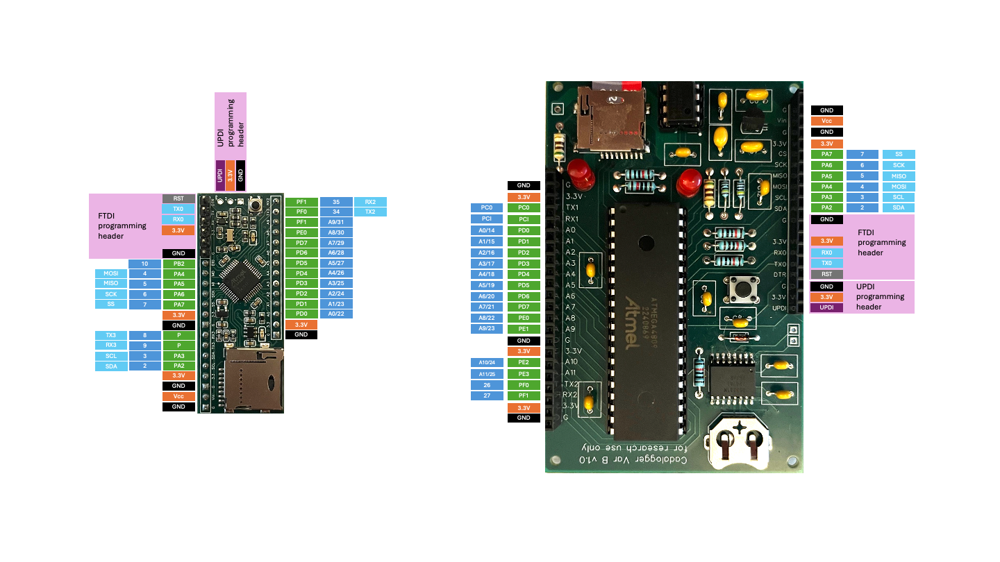
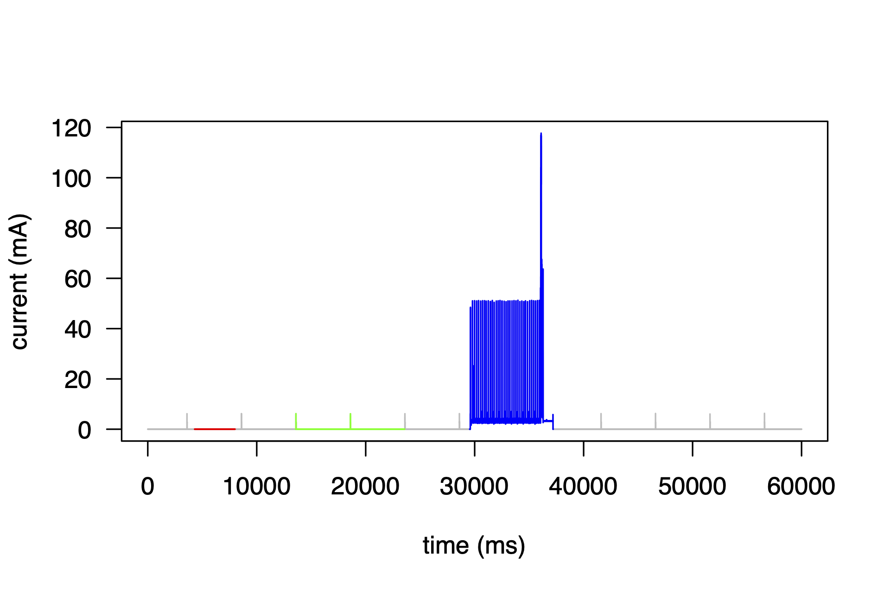
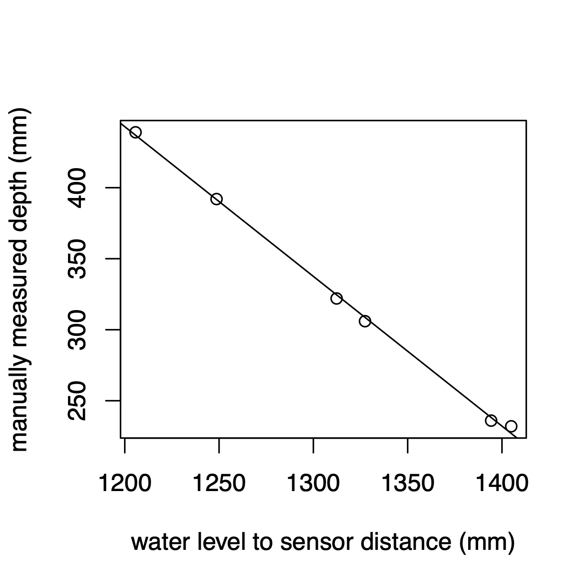
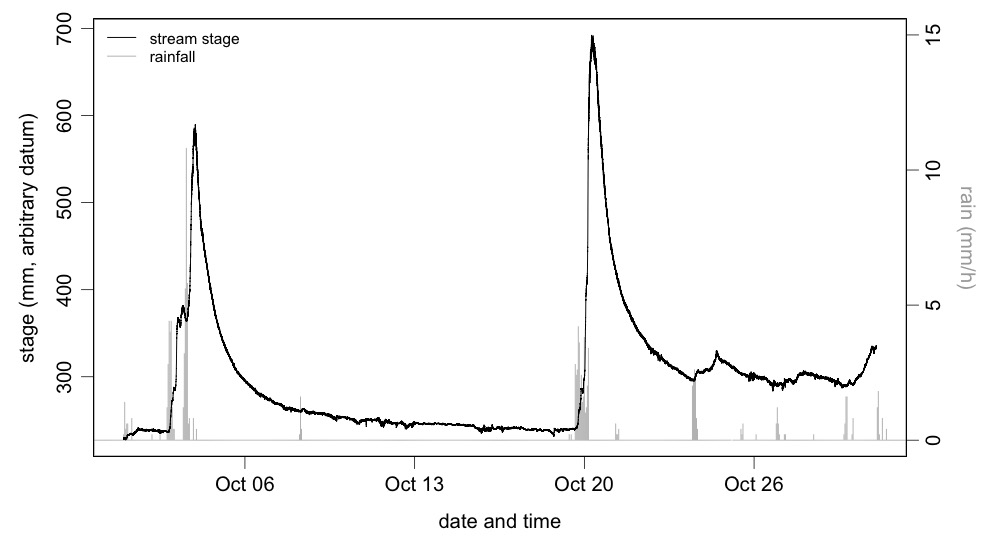
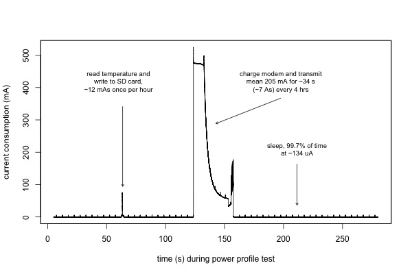
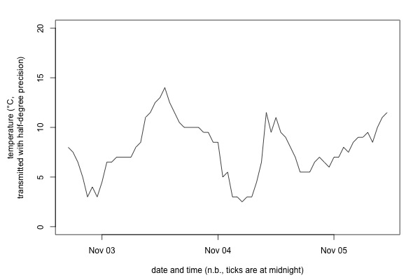

# cadalogger
arduino-inspired boards to support data logging in ecology and environmental science

cadal = sleep in Scots Gaelic: ability to sleep very efficiently is a key feature

logger: data logging

## Preamble

This project aims to generate easy-to-use open-source hardware and software for data logging for ecology and environmental science field studies.  The goal is to produce hardware and software for arduino-like (and arduino-compatible) boards that bring together key elements needed for most data loggers, in arrangemets that support low-power field deployments.

## Contents
- [preamble](#preamble)
- [programming information](#programming)
- [library and functions](#library)

## Programming

### MegacoreX

All examples here use an open source arduino core for the family of MCUs that cadalogger boards use: MegaCoreX by MCUDude.  Roughly, the purpose of the arduino core is to translate standard arduino functions into the specific bits of underlying code necessary for a given microcontroller to understand.

MCUDude provides comprehensive information on using MegacoreX.  Here we provide an overview to get started with cadalogger boards.

In the Arduion IDE, go to  'Arduino IDE' -> 'Preferences...'.  Then in the 'Additional board manager URLs' filed, add 
https://mcudude.github.io/MegaCoreX/package_MCUdude_MegaCoreX_index.json .  If you already have, or subsequently add, other URLs, they can just be separated with commas.

An option of 'MegaCoreX' should then appear under 'Tools' -> 'Board'.  Within the 'MegaCoreX' options, select ATmega4809 if using the cadalogger mini version, or 'ATmega4809' if using the cadalogger maxi (optimised for hand-assembly; details below) version.  After selecting the 'ATmega4809' MCU option, go back to 'Tools' -> 'Pinout', and ensure that '48 pin standard' is selected if using the mini version or '40 pin standard' if using the mickey version.  Select 'Tools' -> 'Clock' -> 'Internal 4 MHz'.  Other settings should be as default: 'Tools' -> 'BOD' -> 'BOD 2.6V', 'Tools' -> 'EEPROM' -> 'EEPROM retained', 'Tools' -> 'Reset pin' -> 'Reset', 'Tools' -> 'Bootloader' -> 'Optiboot (UART0 default pins)', and 'Tools' -> 'Programmer' -> 'Serial UPDI (57600 baud)'.

If your board has a bootloader, you can skip to 'Cadalogger library'.

### Programming

If your board has been provided with a bootloader pre-burned, then programming will typically be done using a USB to Serial adapter.  A 3.3V model is required.  Cadalogger boards have been tested with several.  We have used the [Sparkfun basic FTDI breakout](https://www.sparkfun.com/sparkfun-ftdi-basic-breakout-3-3v.html) with success (also available [here](https://thepihut.com/products/sparkfun-ftdi-basic-breakout-3-3v), [here](https://cpc.farnell.com/sparkfun-electronics/dev-09873/ftdi-basic-breakout-33v/dp/MK00666) and elsewhere).  Connect the USB-serial adapter to the six pin headers on the cadalogger, and connect it to your computer with an appropriate USB cable.  The adapter should appear in the Arduino IDE as a new entry under 'Tools' -> 'Port'; once selected, sketches can be uploaded to the cadalogger board using the upload button.

### Uploading a bootloader

A new build of a cadalogger board will need an bootloader to be burned.  This allows the microcontroller to receive further programming instructions over serial.

Using a SerialUPDI adapter, see above, you will want to set up as follows

- SerialUPDI connector inserted between USB-serial converter module, and conected to GND, V and UPDI on cadalogger board

- Tools > Board > MegaCoreX > ATMega4809
- Tools > Port > as appropriate for your USB-serial adapter
- Tools > Bootloader > Optiboot (UART0 default pins)
- Tools > Clock > Internal 4 MHz
- Tools > Pinout > 48 pin standard for a mini board and 40 pin standard for a mickey board
- Tools > Reset pin > reset

Once set up, selecte Tools > Burn Bootloader.  A bootloader shoud be uploaded, and subsequent uploading of compiled sketches should be possible directly using a USB-serial 
module and the 6-pin serial header pins.

## Pinouts

## Library

The library files (cadalogger.h and cadalogger.cpp) available in the `/src` directory of this repository can either be included in a folder titled `cadalogger` in your local `/Arduino/libraries/` directory, or can be included in the same directory and any sketch (i.e., `.ino` file in the Arduino IDE) that uses them.  They can then be included in a sketch in the usual way using `#include "cadalogger.h"` or '#include <cadalogger.h>'

### Functions

    
`cadalogger(byte boardVersion)`

- constructor
- `boardVersion=0` for small surface mount board ('mini')
- `boardVersion=1` for hand-assembled largely through hole version ('mickey')

`void initialise()`

- sets pin states to minimise power loss, sets up RTC
- heartbeat is interval in seconds for a periodic RTC interrupt, and is used to allow sleep modes with regular wake-up
- arbitrary heartbeat intervals are allowed on if boardVersion==CADALOGGERMINI, for boardVersion==CADALOGGERMINI, 5s is currently required

`void flash(byte flashes)`

- flashes the onboard LED with 10ms on and 90ms off cycle
- sleeps the MCU while the LED is on and off to reduce power consumption relative to blinking with delay()

`void rest(int cycles)`

- alternative to delay() that sleeps the MCU rather than idling with full current consumption
- cycles is in units of 1024 hz cycles, so, a low-poer alternative to delay(1000) is rest(1024)

`void update_time()`

- copies time from the RTC to cadalogger::time array
- calling update_time() will normally be done immediately before any need to access the correct time information from cadalogger::time

`void power_up_sd()`

- powers the uSD card circuitry, connects SPI interface to the uSD, and initialises the card

`void power_down_sd()`
`void power_down_sd(bool wait)`

- disconnects the SPI interface from the uSD and powers down the uSD
- power_down_sd() will include a 1 second low power delay to allow the SD card to perform internal maintenance, following the SD card specification
- power_down_sd(wait=false) will skip the 1 second delay in powering down; recommended only if the delay is otherwise ensured in code; potentially useful if 1s of blocking by power_down_sd() is incompatible with a given application

`void setHeartBeat(int interval)`

- used only with the 'mini' cadalogger version.
- set's the RTC's periodic countdown timer interrupt for the specified interval, in seconds
- may be used in conjunction with `go_to_sleep_until_RTC_wake()`, to wake at regular intervals

`sleepToRTCwake()`

- sleeps the MCU until an interrupt is generated by the RTC; requires that a hearbeat has been set using cadalogger::initialise(int heartbeat);

`void sleepFor(int seconds)`

- will sleep for specified number of seconds, waking every 5 seconds to flash the onboard LED and to perform a watchdog timer reset

`byte wakeOnSecondMultiple(int s)`

- will sleep sleep until a multiple of s seconds is reached
- for example, if invoked at 14:43:22, with `s=10`, the logger will wake and continue the sketch at the next multiple of 10s, or at 14:43:30
- wake times are precise relative to the time on the RTC for the 'mickey' board, becuase it's RTC has a 'wake on second alarm'
- modest (< +/- 2s) errors in the wake up time on 'mini' boards currently occur.

`void enable_watchdog()`
`void disable_watchdog()`

- enable and disable watchdog timer.  Currently only implements watchdog interval of about 8.1s.  If feed_watchdog() is not used within any 8.1s period, a reset will occur

`void feed_watchdog()`

- reset watchdog timer (see immediately above)

void write_time_to_rtc();

- copies the time in cadalogger::time array to the RTC.  Used in setting the time.

`double rtc_temp()`

- returns the temperature in degrees C as measured by the board's RTC.
- this temperature measurement is imprecise, but useful for documenting the environmental conditions to which the logger has been exposed

`float supply_voltage()`

- returns the voltage on the Vin pin

### Cadalogger public variables

`cadalogger::time`

- an array containing the date/time in second, minute, hour, day, month, year

`cadalogger::SD`

- an instance of SD from library SdFat

## Examples

See /examples for various arduino sketches.  This section elaborates on selected examples.

### Stream stage data logger

This project uses a [maxbotix ultrasonic distance sensor](https://maxbotix.com/products/mb7388) to measure distance to the water surface of a stream.  To reduce power consumption, power is cut to the module between reads.  To reduce noise (insects, rain), each read cycle collects 10 distance measurements at a rate of 2 Hz, the highest and lowest are discarded, and the rest averaged.  Because the sensor uses UART and must be positioned some distance (approx 1m) from the logger box, some measures are taken to ensure reliable communication over a shielded cable.  See /examples/stream_stage/stream_stage.ino for code.

<table>
  <tr>
    <td width="500">
      
    </td>
  </tr>
</table>

*Schematic for sensor-end connections for stream_stage*

On the maxbotix distance sensor, the 3.3V power supply is pin 6 and ground is pin 7.  The sensor transmits TTL/UART output on its pin 5.  On the logger end, the sensors Tx output is connected to Rx2, and the power switch is controlled by pin A0.

<table>
  <tr>
    <td width="500">
      
    </td>
  </tr>
</table>
*Power profile for stream_stage logger*

Current consumption is 14 uA at rest (e.g., red section), but including blinks each time the sleep function wakes to reset the watchdog timer (e.g., green section), sleep current sonsumption is about 24 uA.  On waking, collecting 10 readings from the distance sensor, and writing the mean of the 8 middle readigns to the SD card (i.e., blue section) current consumption is on average about 4.3 mA, with a peak during the uSD card write of about 120 mA.  Average current consumption across the whole duty cycle (in this example of one data record per minute) is 572 uA.

Assuming a usable capacity of 2000 mAh in a battery pack of series AA batteries (3 series AAs in this case), the longevity of the logger would be 2000 mAh / 0.572 mA / 24 = 145 days or 4 to 5 months.  n.b., quality AA batteries are typically rated for somewhat more than 2000 mAh, but under field conditions of fluctuating temperature, etc., I find this calculation instructive.

If the logger's duty cycle was adjusted to generate one record every five minutes, current consumption would be 4.3 mA on average over the same period of 7.7 seconds required to make a record and write it to the SD card.  Current consumption would be an average of 24 uA over teh remaining 5 m * 60 s/m - 7.7s = 192.3 s or 97.4% of the duty cycle.  Mean current consumption over the duty cycle would be 4300 uA * 0.026 + 24 uA * 0.974 = 135 uA.  Theoretical longevity on a series AA battery pack would be 616 days.

The logger was deployed on the Kenley Water, near Boarhills, Fife, Scotland.  Six manual measurements of stream depth (taken from a consistent location on an identifiable section of beadrock) were taken between 30 September 2025 and 5 October 2025. These were related to sensor-to-water surface distance measures, averaging data logger records from two minutes prior to two minutes after each manual measurement.  The calibration curve has a slope of -1.054 and an $r^2$ of 0.9986.

*calibration for stream_stage logger*

*example data for stream_stage logger*

*Thoughts about this stream stage logger project*
- this installation washed away in a big flood in December 2025 (-100 pts for fieldcraft)
- future test to include temperature, and will use a pressure-based in-stream logger (with a barometric pressure sensor to correct for changing atmospheric pressure)

### Satellite data transmission

While the cadalogger's main purpose is to provide inexpensive, high-quality, open source core data logging functionality (i.e., interface with sensors, good time keeping, local data storage, and ultra low-power sleep), the loggers can interface with arbitrary peripherals, including, for example different kinds of modems.  This example demonstrates efficient use of a [RockBlock9603 Iridium satellite modem]([https://thepihut.com/products/sparkfun-ftdi-basic-breakout-3-3v](https://www.groundcontrol.com/product/rockblock-9603-compact-plug-and-play-satellite-transmitter/)) (hardware cost, approx £300; see ongoing costs below) for data transmission, in addition to local data storage. 

*power profile for cadalogger with Iridium satellite transmissions*

*Example of data transmission with the Iridium satellite modem controlled by a cadalogger module and optimised for efficient power consumption.*

*example power budget*
- each transmission costs about 7 As (amp-seconds a mean of 207 mA for 34 seconds)
- each wake to read from the DS18b20 temperature sensor, and to write data to the uSD card costs about 12 mAs (mean of 6 mA for about 2s)
- if the logger reads temperature (and stores it locally) every hour, and transmits accumulated data every 4 hours, it will be asleep (at about 134 uA) 99.7% of the time
- this duty cycle of sensor reading and modem use gives an overall mean current consumption of 0.63 mA
- this example project uses a 3x D cell series battery pack.  D cells have substantial capacity (the pack has about 15,000 mAh capacity), but also they can provide the current needed to charge the modem's super capacitors, even at low temperature).
- to be conservative, I assume 50% usable battery pack capacity (e.g., risk of failure to provide adequate on a very cold night by a part discharged battery pack)
- longevity might reasonable be: 15,000 mAh * 50% / 0.63 mA = 11962 hours of run time or 498 days

*controlling monetary cost*
- this is a short test, so the Iridium line rental (£12/month) and data transmission costs are not a large issue, however, in the long-run, they could add up!
- this project (see code in /examples/iridium/) measures temperature every hour, but transmits accumulated data only every 4 hours
- each data transmission costs one credit (cost per credit depends on scale, see below) for up to 50 bytes of payload data
- timestamps are scaled to 144 10-mintute intervals per day (to take only 1 byte) per timestamp
- temperature is scaled to a number between 0 and 200 (fits in 1 byte) representing temperatures between -50 and +50 degrees C, in half degree precision
- note that this scheme represents extremely tight packaging of data -- lots more data could be transmitted within 50 bytes, either by similarly tightly packing each byte, or transmitting more variables, more precision, or more accumulated reads
- each transmission is attempted twice, and contains duplicate information (time stamps and data from previous 4 hours and the 4 hours before that, whereby each data has four transmission attempts) to give maximum chance of transmission (n.b., all transmissions during the test - data in the figure - were successful on the first attempt).
- in this scheme, the monetary budget for a year would be line rental (12 months at £12/month = £144) and £200-400 for transmission credits (6 sub-50 byte transmissions per day = 6 credits per day = 2190 credits per year), depending on the bundle size purchased

*Thoughts about this satellite transmission example*
- This project sleeps the modem by completely cutting power.  The system has a more subtle 'enable' pin, but it was hard to get it to sleep with that pin - it has odd voltage requirements.  It is worth another try in the future.
- I was unnecessarily stingy, packing each timestamp and datum into a single byte -- that was more an exercise in 'how low can you go' than intended to be practical!
- RockBlock has a [new modem](https://www.groundcontrol.com/product/rockblock-9704/) that uses less power and is worth looking into; however, minimum input voltage requirements suggest it may not be as able to use the full capacity of a nominal 4.5V battery pack

